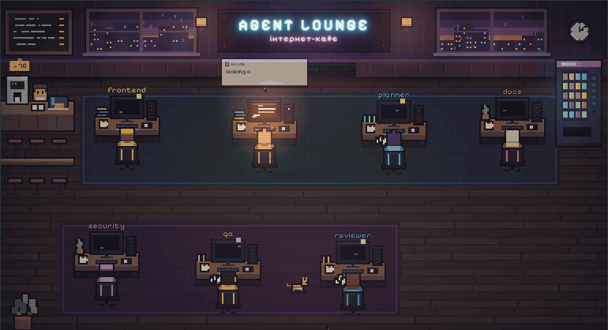

# Agent Lounge

**Watch your Claude Code agents work in a pixel café.**

<p align="center">
  
</p>

Every Claude Code chat becomes a room in the café. Claude sits at its desk. When it starts a subagent, it walks over
and hands it the task; the subagent works with a bubble saying what it's doing, then carries the result back. Your
whole team from `.claude/agents` has a desk, even before it's called.

- **Live:** who is busy and what they're doing right now, in plain words.
- **Pings:** a sound and a phone push when Claude asks for permission or finishes its answer.
- **Tokens and limits:** tokens per agent and chat, and your 5-hour and weekly subscription limits.
- **Teams:** several people connect their Claude to one café, each on their own floor.
- **For the waiting:** a daily recap, achievements, furniture you earn with work, and mini-games with whoever is watching.

The hooks are async and silent: they never slow Claude down and cost no tokens. Run locally, the café keeps
everything on your computer. On your own site, only short descriptions of what each agent does reach it, not file
contents (unless you turn on away mode to approve Claude's requests from your phone).

## Get started

Agent Lounge runs wherever you put it: on your computer, or on your own site. There is no shared hosted café.

**Locally.** Nothing leaves your computer. Needs Node 18+:

```bash
git clone https://github.com/justbios/agent-lounge.git ~/agent-lounge
cd ~/agent-lounge && npm install
npm run setup   # hooks + the café at http://127.0.0.1:3737
```

Your agents show up from your next prompt. `npm run down` stops the café, `npm run unhook` removes the hooks.

**On your own site.** To watch from your phone or share one café with a team, host it on Vercel with your own
Supabase project; both free tiers are enough for a person or a small team.

1. Create a Supabase project and run the files in `supabase/migrations/` in order (the SQL editor works).
2. Deploy this repo to Vercel with `NEXT_PUBLIC_SUPABASE_URL` and `NEXT_PUBLIC_SUPABASE_PUBLISHABLE_KEY` set (see
   `.env.example`). The three `VAPID_*` variables are only for phone pushes: `npx web-push generate-vapid-keys`.
3. Open `/connect` on your site, copy the phrase and paste it into Claude Code. Works on macOS, Linux and Windows.

**As a Claude Code plugin.** The same hooks, installed through the plugin:

```
/plugin marketplace add justbios/agent-lounge
/plugin install agent-lounge@agent-lounge
/agent-lounge:connect local   # or the line from your site's connect page
```

The café speaks English and Ukrainian (agents' actions in Russian too): it follows your browser, and the language
menu at the top switches it.

## More

- [Detailed guide](docs/guide-uk.md) (in Ukrainian): self-hosting on Vercel + Supabase, how it works, every feature.
- [SECURITY.md](SECURITY.md): what is sent where, and how to report a vulnerability.

## License

[Apache-2.0](LICENSE). The bundled NES homebrew games keep their own licences ([THIRD_PARTY_NOTICES.md](THIRD_PARTY_NOTICES.md)).

Agent Lounge is an independent project, not affiliated with Anthropic. "Claude" and "Claude Code" are trademarks of
Anthropic.
